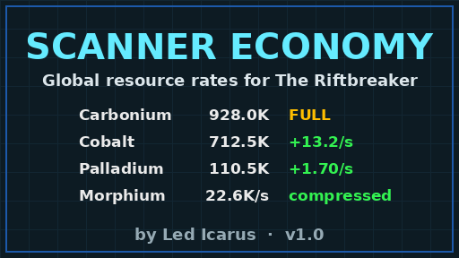

# Scanner Economy

A mod for **The Riftbreaker** that shows your whole planet's economy at a glance.

Hold **Space** at your **HQ**, any **Outpost**, or the **Orbital Scanner** to open the Global Economy panel:

- **Minerals (all outposts):** current stock and net change per second for Carbonium, Ironium, Cobalt, Palladium, Titanium, Crude Uranium and Uranium. Resources at their storage limit are flagged **FULL**, because any surplus is being lost.
- **Compressed liquids (all outposts):** total compression rate per second for each liquid, plus how full its buffer is.

Rates are averaged over the last 60 seconds and restart when you load a map, so give it a minute after arriving.

## Install

- **Steam Workshop:** subscribe in the Workshop or through the in-game Mods menu.
- **Manual:** zip the `lua` and `gui` folders (so they sit at the root of the zip) and put the zip in `<Riftbreaker install>\mods\`. Do not unzip it there.

## How it works

| File | What it does |
| --- | --- |
| `lua/scanner_economy/economy.lua` | Shared code: samples resource amounts once per second, keeps 60 s of history, builds the panel text |
| `lua/buildings/main/headquarters.lua` | Game's HQ/Outpost script plus an interact component so holding Space opens the panel |
| `lua/buildings/main/planet_scanner.lua` | Game's Orbital Scanner script; opens the scanner as usual and the panel on top |
| `gui/popup/scanner_economy.gui` | The panel layout |

Notes for modders:

- Mineral stock is planet-wide, so the net rate is the change in stock over time. A resource at its limit reads 0/s even if it has a surplus.
- Compressed liquids (`<liquid>_compressed`) are flows: `PlayerService:GetResourceLimit` returns the total compressed per second (the Decompressor's "Compressed" column) and `GetResourceAmount` returns a buffer that fills up to it. The "In use" figure isn't exposed to Lua.
- `PlayerService:GetResourceIncome` crashes the game natively. Don't call it.
- The Orbital Scanner hotkey and the build-mode gear button are handled in native code, so they can't open the panel.

## Compatibility

The mod replaces the HQ/Outpost (`headquarters.lua`) and Orbital Scanner (`planet_scanner.lua`) scripts, so it may conflict with other mods that change those buildings.

## Author

Led Icarus
